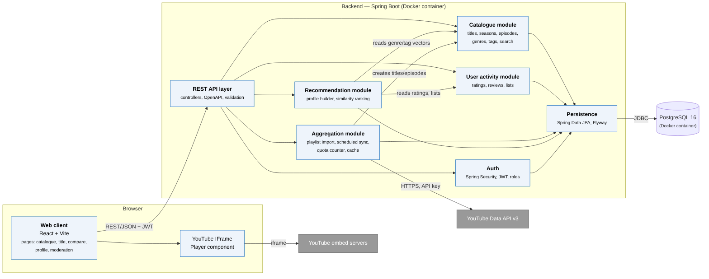
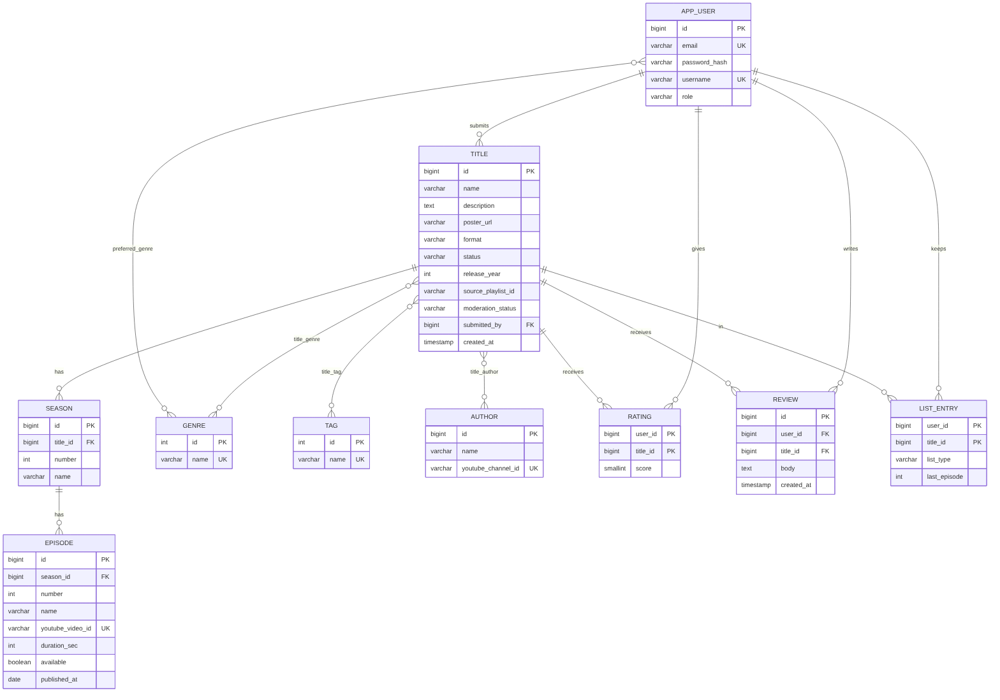

# 7. Architecture and Diagrams

All diagrams are stored as editable source files in [`diagrams/src`](../diagrams/src): Mermaid `.mmd` and Graphviz `.dot`. Readable exports are in [`diagrams/export`](../diagrams/export) as PNG and SVG. To regenerate them:

```bash
npx -p @mermaid-js/mermaid-cli mmdc -i diagrams/src/system-context.mmd -o diagrams/export/system-context.png
dot -Tpng diagrams/src/use-case.dot -o diagrams/export/use-case.png
```

## 7.1 System context diagram


AniAtlas is used by three kinds of people: viewers (guests and registered users), authors and moderators. It depends on two external systems from YouTube:

- The **Data API v3** is used server-side to import playlist and video metadata and to check video availability.
- The **IFrame Player** is used client-side for playback. The video stream goes directly from YouTube to the viewer's browser, so AniAtlas never stores or proxies video (NFR-6).

## 7.2 Use case diagram


| Use case | Actor | Requirements |
|---|---|---|
| UC-1 Search and filter catalogue | Guest | FR-4, FR-5, FR-6 |
| UC-2 View title page | Guest | FR-3 |
| UC-3 Watch episode | Guest | FR-7, FR-8 |
| UC-4 Register / log in (includes choosing favourite genres) | Guest | FR-9, FR-18 |
| UC-5 Rate and review | Viewer | FR-10 |
| UC-6 Manage watch lists | Viewer | FR-11 |
| UC-7 Compare titles | Viewer | FR-12 |
| UC-8 Submit title by playlist URL | Author | FR-13 |
| UC-9 Moderate submissions, genres and tags | Moderator | FR-15, FR-19 |
| UC-10 Get recommendations | Viewer | FR-16, FR-17 |
| UC-11 Sync metadata (scheduled) | YouTube (system) | FR-8, FR-14 |

Actor generalisation: Viewer inherits Guest; Author and Moderator inherit Viewer.

### Main scenario: UC-8 Submit title

1. The author pastes a YouTube playlist URL and chooses genres and tags.
2. The system validates the URL and fetches the playlist, its items and video details from the Data API.
3. The system creates the title with status PENDING, one season, and an episode for each video.
4. The moderator reviews the title in the queue, edits it if needed, and approves it.
5. The title becomes visible in the catalogue.

**Alternative flows:** if the URL is invalid or the playlist is private, the system shows an error (400). If the daily quota is exhausted, the submission is queued for the next day.


## 7.3 Component diagram (draft)



| Component | Responsibility | Main requirements |
|---|---|---|
| Web client (React) | Pages: catalogue, title, comparison, profile, moderation | FR-3, FR-5, FR-12 |
| YouTube Player component | Wraps the IFrame Player API; shows "unavailable" state | FR-7, FR-8 |
| REST API layer | Controllers, validation, OpenAPI docs, error handling | All |
| Auth | Registration, login, JWT, roles USER/AUTHOR/MODERATOR | FR-9, NFR-2 |
| Catalogue module | Titles, seasons, episodes, genres, tags; full-text search and filters | FR-1…FR-6, FR-19 |
| User activity module | Ratings, reviews, lists | FR-10, FR-11 |
| Aggregation module | Playlist import, scheduled sync, quota counter, response cache | FR-13, FR-14, NFR-3 |
| Recommendation module | Builds preference profiles, ranks titles, explains results | FR-16…FR-18 |
| Persistence | JPA repositories, Flyway migrations | — |
| PostgreSQL | Data storage, full-text index | NFR-1 |

**Architectural style:** a modular monolith. Each module is a separate Java package with its own service interfaces, and modules communicate only through those interfaces. This keeps deployment simple for the MVP while still allowing modules to be split into separate services later. Splitting the Aggregation module first is the most likely step, because of its scheduled load.

**Deployment:** Docker Compose with three containers: `frontend` (nginx serving the built React app), `backend` (Spring Boot) and `db` (PostgreSQL). Secrets (DB password, YouTube API key, JWT secret) are passed as environment variables from `.env`, which is not committed (see [`.env.example`](../.env.example)).

## 7.4 Data model



- `RATING` and `LIST_ENTRY` use the composite key `(user_id, title_id)`, so each user has at most one rating and one list entry per title.
- `EPISODE.youtube_video_id` is unique.
- `TITLE` has a full-text index over `name` and `description` (`tsvector`, GIN).

## 7.5 Recommendation algorithm

1. Each title is a binary vector over genres and tags, **g**.
2. User profile **p** = Σ (rating − user's mean rating) · **g** over rated titles + 1.0 · **g** for titles in the "watching" or "completed" lists + 1.0 for each genre chosen at sign-up.
3. Score(title) = cos(**p**, **g**) + 0.05 · normalised average rating; titles already in the user's lists are excluded.
4. The explanation lists the top 2 shared genres or tags.

## 7.6 Alignment check

| Use case | Components involved | Data entities |
|---|---|---|
| UC-1 | Web client → API → Catalogue | TITLE, GENRE, TAG |
| UC-3 | Web client → Player → YouTube | EPISODE |
| UC-5/6 | Web client → API → Auth → User activity | RATING, REVIEW, LIST_ENTRY |
| UC-8 | Web client → API → Aggregation → YouTube Data API | TITLE, SEASON, EPISODE, AUTHOR |
| UC-10 | Web client → API → Recommendation → Catalogue, User activity | APP_USER, RATING, LIST_ENTRY, GENRE |

The draft REST API is described in [api.md](api.md).
