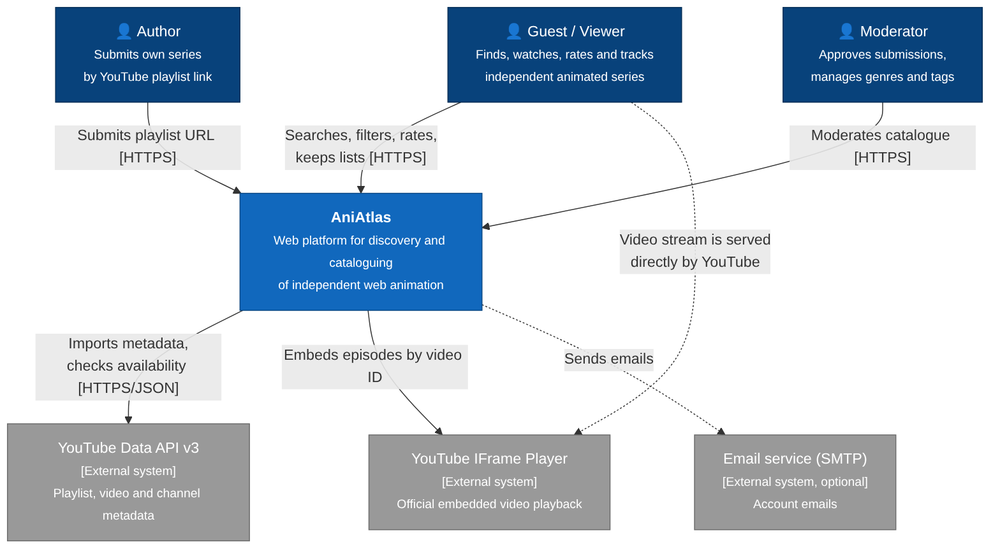
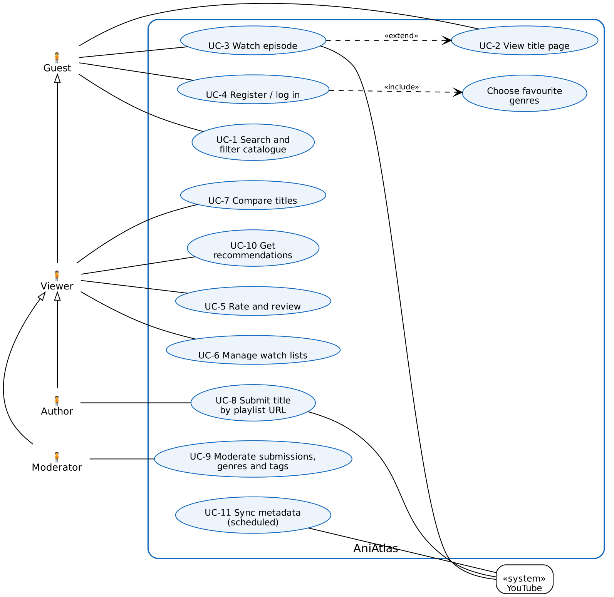
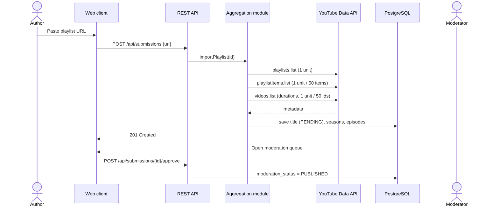

# 7. Architecture and Diagrams

All diagrams are stored as editable source files in [`diagrams/src`](../diagrams/src): Mermaid `.mmd` and Graphviz `.dot`. Readable exports are in [`diagrams/export`](../diagrams/export) as PNG and SVG. To regenerate them:

```bash
npx -p @mermaid-js/mermaid-cli mmdc -i diagrams/src/system-context.mmd -o diagrams/export/system-context.png
dot -Tpng diagrams/src/use-case.dot -o diagrams/export/use-case.png
```

## 7.1 System context diagram



AniAtlas is used by three kinds of people: viewers (guests and registered users), authors and moderators. It depends on two external systems from YouTube:

- The **Data API v3** is used server-side to import playlist and video metadata and to check video availability.
- The **IFrame Player** is used client-side for playback. The video stream goes directly from YouTube to the viewer's browser, so AniAtlas never stores or proxies video (NFR-6).

## 7.2 Use case diagram



| Use case | Actor | Requirements |
|---|---|---|
| UC-1 Search and filter catalogue | Guest | FR-4, FR-5, FR-6 |
| UC-2 View title page | Guest | FR-3 |
| UC-3 Watch episode | Guest | FR-7, FR-8 |
| UC-4 Register / log in (includes choosing favourite genres) | Guest | FR-9, FR-18 |
| UC-5 Rate and review | Viewer | FR-10 |
| UC-6 Manage watch lists | Viewer | FR-11 |
| UC-7 Compare titles | Viewer | FR-12 |
| UC-8 Submit title by playlist URL | Author | FR-13 |
| UC-9 Moderate submissions, genres and tags | Moderator | FR-15, FR-19 |
| UC-10 Get recommendations | Viewer | FR-16, FR-17 |
| UC-11 Sync metadata (scheduled) | YouTube (system) | FR-8, FR-14 |

Actor generalisation: Viewer inherits Guest; Author and Moderator inherit Viewer.

### Main scenario: UC-8 Submit title

1. The author pastes a YouTube playlist URL and chooses genres and tags.
2. The system validates the URL and fetches the playlist, its items and video details from the Data API.
3. The system creates the title with status PENDING, one season, and an episode for each video.
4. The moderator reviews the title in the queue, edits it if needed, and approves it.
5. The title becomes visible in the catalogue.

**Alternative flows:** if the URL is invalid or the playlist is private, the system shows an error (400). If the daily quota is exhausted, the submission is queued for the next day.




<!-- Sections 7.3–7.6 (component diagram, data model, recommendation algorithm, alignment) are added in ANI-4. -->
